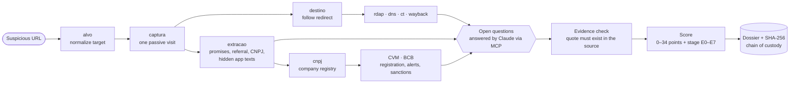

# Ponzi Radar

**Passive OSINT risk scoring for Ponzi and pyramid investment schemes: a Python pipeline and an MCP server for Claude.**

**English** · [Português (Brasil)](README.pt-BR.md)


Ponzi Radar analyzes a suspicious investment website and produces an evidence-backed **risk dossier**. Typical targets are crypto plans with "daily yield", referral networks, and "guaranteed returns". The dossier answers two questions:

1. **How likely is it to be a Ponzi or pyramid scheme?** The answer is a score from 0 to 34 on a 15-item matrix.
2. **Where is it in the scheme life cycle?** The answer is a stage from E0 (launch) to E7 (post-collapse).

It works like an outside observer. It makes one ordinary browser visit to the site, then relies only on public records: domain registration, DNS, certificate transparency, the Wayback Machine, the company registry, and regulator data. An AI client (Claude, through MCP) answers the questions that need human-style reading. Every quote it gives is checked against an archived copy of the source before it counts.

> The dossier supports an analysis. It is not proof and not an accusation. The scoring matrix is a documented heuristic that has not been statistically validated yet (see [Roadmap](#roadmap)).

## Contents

- [Why](#why)
- [Features](#features)
- [How it works](#how-it-works)
- [Quick start](#quick-start)
- [Usage](#usage)
- [The risk matrix](#the-risk-matrix)
- [Example output](#example-output)
- [Research](#research)
- [Scope and limitations](#scope-and-limitations)
- [Responsible use](#responsible-use)
- [Project layout](#project-layout)
- [Roadmap](#roadmap)
- [FAQ](#faq)

## Why

Ponzi and pyramid schemes rarely die: they come back with a new domain, a new name and the same mechanics. By the time a regulator publishes an alert, most victims have already deposited. The signals usually exist much earlier:
- a domain registered last week;
- a promised daily return;
- a multi-level referral bonus;
- no company registration;
- a "fee" to release a withdrawal.

Ponzi Radar collects those signals systematically. It keeps a verifiable trail for each one and runs again later to show what changed.

## Features

- **Passive by design.** Only the capture node touches the target. It makes one visit with headless Chromium, like a normal visitor. It never logs in, submits forms, downloads files, connects wallets, or bypasses anti-bot or CAPTCHA.
- **Public-record collectors.** RDAP (registro.br for `.br`, rdap.org for the rest), DNS over HTTPS, certificate transparency (crt.sh), the Wayback Machine (CDX and snapshots), Brazilian company registry data (CNPJ via BrasilAPI with a fallback), CVM (Brazil's securities regulator) alerts and sanction proceedings, and the list of Central Bank of Brazil (BCB) authorized institutions with their verified domains.
- **Sees through the disguise.**
  - Follows link shorteners and redirects to the real site.
  - Flags expired domains that were re-registered to look old.
  - Reads the hidden texts of single-page apps: the i18n dictionaries embedded in the page often reveal referral levels, bonus rules and "withdrawals are blocked" messages that a visitor never sees.
- **AI in the loop, with receipts.** The pipeline opens *open questions* (pendências). Claude answers them through MCP, and each answer must cite a source: an archived artifact (SHA-256) or a public URL, with a literal quote. The server checks that the quote really exists in the source and that the dates are consistent with the analysis date.
- **Two-axis score.** Unverified items are shown as a range, never as zero, and cut-off rules set a minimum (or fixed) class. A life-cycle stage (E0–E7) comes with the time windows observed in past schemes.
- **Chain of custody.** Every artifact is stored with a chained SHA-256 log, and `radar verificar` recomputes the chain.
- **History and diff.** Analyzing the same target again shows what changed: new partners, new promises, a site that went offline, a different destination domain.
- **Modes.**
  - *No contact*: Wayback only; the site is never visited.
  - *Retroactive*: analyzes the site as it was on a given date.
  - *Blind*: masks everything that identifies the target, for calibration.
- **Operator OPSEC.**
  - Proxy and Tor support.
  - WebRTC is disabled so the real IP does not leak behind a proxy.
  - Requests to `localhost` and private IP addresses are blocked, redirect hops included.
  - The browser uses its own native user agent and does not hide automation, because Ponzi Radar does not evade anti-bot protection.

## How it works



The pipeline is a DAG executed with Python's `graphlib.TopologicalSorter`. Each node is a deterministic collector, so the same inputs give the same outputs, and nodes that fail or are skipped become explicit gaps in the dossier. Claude does not compute the score: it only answers the open questions, and the score is computed deterministically from the verified answers.

## Quick start

Requires Python 3.12 or newer.

```bash
git clone https://github.com/FFloriani/ponzi-radar.git
cd ponzi-radar/radar
python -m venv .venv
source .venv/bin/activate          # Windows (Git Bash): source .venv/Scripts/activate
pip install -e ".[dev]"
playwright install chromium
python -m pytest -q                # offline test suite
```

Live tests that query the real sources are kept apart: `python -m pytest -m rede -v`.

Settings are in `radar/config.toml`, with the defaults commented: proxy, per-host rate limits, timeouts and number of subpages. Put machine-specific overrides in `radar/config.local.toml`, which is git-ignored.

## Usage

### With Claude Code (recommended)

The `.mcp.json` at the repository root registers the `radar` MCP server.

1. Open Claude Code at the repository root and approve the project server.
2. Check with `/mcp` that `radar` is connected.
3. Run the guided analysis:

   ```
   /mcp__radar__analisar_site https://suspicious-site.example
   ```

Claude starts the analysis, answers every open question with evidence, generates the dossier and summarizes both axes and the gaps.

The `.mcp.json` points to the Windows virtualenv (`radar/.venv/Scripts/python.exe`). On Linux and macOS, use `radar/.venv/bin/python`.

### With Claude Desktop or another MCP client

Add the server to `claude_desktop_config.json`, using absolute paths, and restart the app:

```json
{
  "mcpServers": {
    "radar": {
      "command": "/path/to/ponzi-radar/radar/.venv/bin/python",
      "args": ["-m", "radar.mcp_server"],
      "env": { "PLAYWRIGHT_BROWSERS_PATH": "/path/to/ms-playwright" }
    }
  }
}
```

The `env` line is only needed if you installed the Playwright browsers in a custom path. Claude Code passes your whole environment to the server, but some other clients pass a reduced one.

MCP tools: `iniciar_analise`, `status`, `listar_pendencias`, `ver_pendencia`, `ver_artefato`, `arquivar_fonte`, `responder_pendencia`, `gerar_dossie`, `comparar_execucoes` and `listar_casos`. There is also the `analisar_site` prompt.

### Command line

| Command | What it does |
|---|---|
| `radar coletar URL [--as-of YYYY-MM-DD] [--sem-contato] [--cego]` | Runs the collectors and prints the `run_id` and the open questions. |
| `radar verificar RUN_ID` | Recomputes the chain of custody and every artifact hash. |
| `radar dossie RUN_ID [--forcar]` | Builds the dossier (`--forcar` turns open questions into "not verified"). |
| `radar diff SLUG [--a RUN_ID] [--b RUN_ID]` | Compares two runs of the same target. |
| `radar mcp` | Starts the MCP server over stdio. |

Runs are stored in `casos/<slug>/<YYYY-MM-DD_HHMMSS>/` (artifacts, custody log, node state, answers, `dossie.md`). **`casos/` is never committed**, because it may contain personal data collected from the sites.

### Redirects and shorteners

If the URL leads to another domain, the radar analyzes the destination and records the redirect in the dossier. This works in capture mode only. A redirect to a platform (Telegram, WhatsApp, Instagram), a domain-parking service or a third-party service (app store, checkout, file hosting) does not change the analyzed domain. Without contact, or in retroactive mode, the redirect is not seen, so give the final domain yourself.

## The risk matrix

**Axis 1: probability (0–34 points).**

| Group | Item | Max |
|---|---|---|
| A. Return | A1 Fixed or guaranteed return (daily yield scores the maximum) | 4 |
| | A2 Unrealistically smooth return history | 2 |
| | A3 Unverifiable source of returns and no independent custodian | 2 |
| B. Mechanics | B1 Paid for recruiting or referring | 3 |
| | B2 Payment in the operator's own token or internal currency | 2 |
| | B3 Lock-up with a heavy exit penalty | 1 |
| | B4 Fee required to release a withdrawal | 3 |
| C. Legal form | C1 No registration or authorization (CVM/BCB) | 3 |
| | C2 Atypical contract (e.g. "crypto rental", "partnership", principal never returned) | 2 |
| | C3 Personal or third-party account, no company ID, offshore claims | 2 |
| | C4 Active official alert | 3 |
| D. People and identity | D1 Operators with a fraud history | 3 |
| | D2 Clone of a known scheme | 2 |
| | D3 New identity (domain or company under 12 months) | 1 |
| | D4 Borrowed credibility (influencers, celebrities, religious leaders) | 1 |

Classes: 0–4 *no strong structural signal* · 5–9 *suspicious* · 10–16 *probable* · 17–34 *characteristic*. The cut-off rules work like this:
- a fixed return with no registration forces at least *probable*;
- a withdrawal fee forces *characteristic*;
- documentary proof that old investors were paid with new deposits forces *confirmed*.

**Axis 2: life-cycle stage.**

| Stage | Meaning |
|---|---|
| E0 | Launch: new domain or company |
| E1 | Withdrawals work, testimonials |
| E2 | Accelerated expansion, influencers, events |
| E3 | Rate escalation, new plans, contract changes |
| E4 | Payment delays, withdrawal limits, "system maintenance", withdrawal fees |
| E5 | Own token, migrated balances, installment payments, settlements |
| E6 | Site offline, payments stopped, police operation |
| E7 | Post-collapse: promised comeback, leaders starting a new scheme |

Each stage comes with the time window observed in past cases, which is a description and not a prediction, and with modifiers that shorten or lengthen it.

## Example output

This excerpt comes from the end-to-end test against a synthetic scheme site (`radar/tests/ouro/dossie_sintetico.md`). Dossiers are written in Portuguese:

```text
### Eixo 1: probabilidade de pirâmide ou Ponzi
- Escore: 15–17 de 34
- Classe: provável (pode chegar a característico)
- Regras de corte disparadas: R1: classe mínima provável

### Eixo 2: estágio do ciclo de vida
- Estágio: E2
- Sinal que o define: expansao_acelerada, fonte operador
- Modificadores: retorno_alto (encurta) · identidade_nova (encurta) · carencia_longa (alonga)
```

In English: a score of 15–17 out of 34, classed *probable* (it may reach *characteristic*), with rule R1 triggered. The stage is E2, accelerated expansion, set by a signal from the operator's own site. Every matrix item in the full dossier lists its quote, source, date and artifact hash, and the dossier ends with a timeline, the company and partners, infrastructure, gaps, the changes since the previous run, and the custody annex.

## Research

The scoring matrix and the stage model come from two research reports, written in Portuguese and with sources, in [`reports/`](reports/):

- **[Pirâmides financeiras no Brasil](reports/Pirâmides%20financeiras%20no%20Brasil.md)** covers concepts, the legal framework, regulators, cases from 1990 to 2026, red flags and what victims can do.
- **[Duração e colapso das pirâmides](reports/Duração%20e%20colapso%20das%20pirâmides.md)** covers the timeline of about 70 schemes in Brazil and worldwide, including Madoff, MMM, TelexFree, BitConnect, OneCoin and PlusToken. It describes the patterns of duration and collapse, the E0–E7 stage model and the two-axis matrix.

The supporting notes are in [`research_notes/`](research_notes/). The design spec and the implementation plans are in [`docs/superpowers/`](docs/superpowers/).

## Scope and limitations

- **Brazil-first data.** Company, regulator and central bank collectors use Brazilian sources (CNPJ, CVM, BCB). The infrastructure collectors (RDAP, DNS, certificate transparency, Wayback) and the capture work for any domain, and Claude is guided to check IOSCO I-SCAN and foreign regulators' alerts. The dossier text is in Portuguese.
- **Unvalidated weights.** The matrix weights are a heuristic, and the calibration against historical cases and negative controls is the next subproject.
- **Login walls.** Only what a visitor sees is analyzed, plus the texts embedded in the page; the logged-in area is out of scope.
- **Third-party outages.** Public sources go down (crt.sh, for example). Failed nodes appear as gaps, never as zero.

## Responsible use

- Ponzi Radar observes; it does not attack. It is OSINT, not a penetration-testing tool.
- Personal data stays local. `casos/` is git-ignored and refused by the publishing tool. CPF fields (Brazilian personal tax IDs) from the company registry are discarded, and formatted CPF numbers are masked in the dossier.
- Content from the investigated site is treated as untrusted data and never as instructions for the AI client.
- A high score is a reason to look closer and to report to the authorities: in Brazil, to the CVM, the Federal Police or the public prosecutor. It is not a verdict.

## Project layout

| Path | Contents |
|---|---|
| `radar/` | The Python package (`radar`), the tests and the configuration |
| `radar/radar/nos/` | Pipeline nodes: collectors, capture, extraction and open questions |
| `radar/radar/matriz.yaml` | Scoring matrix, classes, rules, stages and modifiers |
| `reports/`, `research_notes/` | Research behind the matrix |
| `docs/superpowers/` | Design spec (with addenda), implementation plans and decision logs |
| `tools/publicar.py` | Commit helper through the GitHub API |
| `.mcp.json` | MCP server registration for Claude Code |

## Roadmap

- [x] **Core**: DAG pipeline, collectors, capture, extraction, open questions, scoring, dossier, diff, MCP server and CLI.
- [x] **Field-test improvements**: following redirects, flagging re-registered domains, reading hidden app texts.
- [ ] **Calibration**: measure accuracy on historical schemes and negative controls, then fit the weights.
- [ ] More international sources (regulator alert feeds, foreign company registries) and an English dossier.
- [ ] Clone detection (D2) and on-chain signals.

## FAQ

**How can I tell if an investment is a Ponzi or pyramid scheme?**
Look for the signals in the matrix:
- a fixed or "guaranteed" return, especially a daily one;
- returns that come from an unexplained source;
- bonuses for recruiting people;
- no registration with the securities regulator;
- a fee to withdraw your money;
- a brand-new domain or company.

Ponzi Radar checks these systematically and shows the evidence behind each one.

**Is this a hacking or pentest tool?**
No. It is passive OSINT: one visit, like any visitor, plus public records. It never logs in, never submits anything and never evades protections.

**Does it work outside Brazil?**
Partly. The infrastructure analysis, the capture and the open questions work for any site. Company and regulator lookups are Brazilian for now, and so is the dossier language.

**Is the score proof of fraud?**
No. It is a structured, evidence-backed heuristic to prioritize attention. Only authorities and courts establish fraud.

**Which AI clients are supported?**
Any MCP client. It is tested with Claude Code and Claude Desktop. Without an AI client, the CLI runs the collectors and builds a dossier in which the open questions are marked as not verified.

---

Keywords: Ponzi scheme detector, pyramid scheme checker, investment scam, crypto Ponzi, high-yield investment program (HYIP), fraud detection, OSINT, due diligence, risk assessment, MCP server, Claude, certificate transparency, Wayback Machine, Brazil, CVM.
