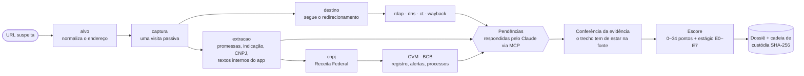

# Ponzi Radar

**Radar de pirâmides financeiras e esquemas Ponzi: análise passiva (OSINT) de sites de investimento suspeitos, com pipeline em Python e servidor MCP para o Claude.**

[English](README.md) · **Português (Brasil)**


O Ponzi Radar analisa um site de investimento suspeito e gera um **dossiê de risco** com evidências. Os alvos típicos são planos de cripto com "rendimento diário", redes de indicação e "retorno garantido". O dossiê responde duas perguntas:

1. **Qual a chance de ser pirâmide financeira ou esquema Ponzi?** A resposta é um escore de 0 a 34 numa matriz de 15 itens.
2. **Em que fase do ciclo de vida o esquema está?** A resposta é um estágio de E0 (lançamento) a E7 (pós-colapso).

O radar trabalha como um observador de fora. Faz uma única visita ao site, como um visitante comum, e no resto só usa registros públicos: registro do domínio, DNS, certificados, arquivo da internet (Wayback), CNPJ, CVM e Banco Central. Um cliente de IA (o Claude, pelo MCP) responde o que exige leitura humana, e cada citação é conferida numa cópia arquivada da fonte antes de valer.

> O dossiê é um apoio à análise, não uma prova nem uma acusação. A matriz que o pontua é uma heurística documentada, ainda não validada estatisticamente (ver [Próximos passos](#próximos-passos)).

## Sumário

- [Por que existe](#por-que-existe)
- [O que ele faz](#o-que-ele-faz)
- [Como funciona](#como-funciona)
- [Instalação](#instalação)
- [Como usar](#como-usar)
- [A matriz de risco](#a-matriz-de-risco)
- [Exemplo de dossiê](#exemplo-de-dossiê)
- [Pesquisa](#pesquisa)
- [Alcance e limitações](#alcance-e-limitações)
- [Uso responsável](#uso-responsável)
- [Estrutura do repositório](#estrutura-do-repositório)
- [Próximos passos](#próximos-passos)
- [Perguntas frequentes](#perguntas-frequentes)

## Por que existe

Pirâmide financeira não morre: volta com outro domínio, outro nome e a mesma mecânica. Quando sai o alerta da CVM, a maioria das vítimas já depositou. Os sinais costumam aparecer bem antes:
- domínio registrado na semana passada;
- rendimento prometido por dia;
- bônus de indicação em vários níveis;
- empresa sem registro;
- "taxa" para liberar o saque.

O Ponzi Radar junta esses sinais de forma sistemática, guarda uma trilha verificável de cada um e mostra o que mudou quando a análise é repetida.

## O que ele faz

- **Passivo por construção.** Só o nó de captura toca o site, numa única visita com Chromium headless, como um visitante comum. Ele nunca faz login, não envia formulário, não baixa arquivo, não conecta carteira e não contorna anti-bot nem CAPTCHA.
- **Coletores de registros públicos:**
  - RDAP (registro.br para `.br` e rdap.org para os demais);
  - DNS sobre HTTPS;
  - transparência de certificados (crt.sh);
  - Wayback Machine (CDX e snapshots);
  - CNPJ (BrasilAPI, com fallback);
  - alertas de atuação irregular e processos sancionadores da CVM;
  - instituições autorizadas pelo Banco Central e os domínios verificados delas.
- **Enxerga o disfarce:**
  - segue encurtadores e redirecionamentos até o site de verdade;
  - avisa quando um domínio expirado foi registrado de novo para parecer antigo;
  - lê os textos internos de aplicativos de página única, os dicionários de tradução que vêm embutidos na página. Eles costumam mostrar níveis de indicação, regras de bônus e mensagens como "Saques de rendimento estão bloqueados", que o visitante nunca vê.
- **IA com comprovante.** O pipeline abre *pendências*, e o Claude as responde pelo MCP. Cada resposta precisa de fonte, um artefato arquivado (SHA-256) ou uma URL pública, com trecho literal. O servidor confere que o trecho existe mesmo na fonte e que as datas batem com a data da análise.
- **Escore em dois eixos.** Item não verificado entra como intervalo, nunca como zero, e regras de corte fixam uma classe mínima (ou fixa). O estágio do ciclo de vida (E0–E7) vem com a janela de tempo observada em esquemas anteriores.
- **Cadeia de custódia.** Cada artefato é guardado com log SHA-256 encadeado, e o `radar verificar` refaz a cadeia.
- **Histórico e comparação.** Analisar o mesmo alvo de novo mostra o que mudou: sócios novos, promessas novas, site fora do ar, outro domínio de destino.
- **Modos:**
  - *sem contato*: só Wayback, sem visitar o site;
  - *retroativo*: analisa o site como ele era numa data;
  - *cego*: mascara o que identifica o alvo, para a calibração.
- **Opsec do analista:**
  - proxy e Tor;
  - WebRTC desligado, para o IP real não vazar atrás do proxy;
  - bloqueio de pedidos a `localhost` e a IP privado, inclusive nos saltos de redirect;
  - navegador com o user agent nativo e sem esconder a automação, porque o radar não contorna anti-bot.

## Como funciona



O pipeline é um DAG executado com o `graphlib.TopologicalSorter` do Python. Cada nó é um coletor determinístico, e nó com falha ou pulado vira lacuna explícita no dossiê. O Claude não calcula o escore: ele só responde as pendências, e a pontuação sai das respostas conferidas.

## Instalação

Precisa de Python 3.12 ou mais novo.

```bash
git clone https://github.com/FFloriani/ponzi-radar.git
cd ponzi-radar/radar
python -m venv .venv
source .venv/Scripts/activate      # Git Bash no Windows; Linux/macOS: source .venv/bin/activate; PowerShell: .venv\Scripts\Activate.ps1
pip install -e ".[dev]"
playwright install chromium
python -m pytest -q                # suíte sem internet
```

Os testes ao vivo, que consultam as fontes de verdade, rodam à parte: `python -m pytest -m rede -v`.

A configuração fica em `radar/config.toml`, com os padrões comentados: proxy, limites por host, timeouts e número de subpáginas. Para mudar um valor só na sua máquina, use `radar/config.local.toml`, que fica fora do git.

## Como usar

### No Claude Code (recomendado)

O `.mcp.json` da raiz registra o servidor MCP `radar`.

1. Abra o Claude Code na raiz do repositório e aprove o servidor do projeto.
2. Confira com `/mcp` se o `radar` aparece conectado.
3. Rode a análise guiada:

   ```
   /mcp__radar__analisar_site https://site-suspeito.com.br
   ```

O Claude inicia a análise, responde cada pendência com evidência, gera o dossiê e resume os dois eixos e as lacunas.

O `.mcp.json` aponta para o venv do Windows (`radar/.venv/Scripts/python.exe`). Em Linux ou macOS, o interpretador é `radar/.venv/bin/python`.

### No Claude Desktop ou em outro cliente MCP

Acrescente o servidor ao `claude_desktop_config.json` (no Windows, em `%APPDATA%\Claude\`), com caminhos absolutos, e reinicie o aplicativo:

```json
{
  "mcpServers": {
    "radar": {
      "command": "C:\\caminho\\para\\ponzi-radar\\radar\\.venv\\Scripts\\python.exe",
      "args": ["-m", "radar.mcp_server"],
      "env": { "PLAYWRIGHT_BROWSERS_PATH": "C:\\caminho\\para\\ms-playwright" }
    }
  }
}
```

A linha `env` só é necessária se os navegadores do Playwright foram instalados num caminho próprio. O Claude Code passa o ambiente inteiro ao servidor; outros clientes podem passar um ambiente reduzido. Sem o navegador, o nó `captura` falha com `captura indisponível: navegador do Playwright não encontrado; ...`. Isso não conta como "site fora do ar" e aparece nas lacunas do dossiê.

Ferramentas MCP: `iniciar_analise`, `status`, `listar_pendencias`, `ver_pendencia`, `ver_artefato`, `arquivar_fonte`, `responder_pendencia`, `gerar_dossie`, `comparar_execucoes` e `listar_casos`. Há também o prompt `analisar_site`.

### Linha de comando

| Comando | O que faz |
|---|---|
| `radar coletar URL [--as-of AAAA-MM-DD] [--sem-contato] [--cego]` | Roda os coletores e imprime o `run_id` e as pendências abertas. |
| `radar verificar RUN_ID` | Refaz a cadeia de custódia e confere o hash de cada artefato. |
| `radar dossie RUN_ID [--forcar]` | Gera o dossiê. Com pendências abertas, só com `--forcar`, e os itens delas viram "não verificado". |
| `radar diff SLUG [--a RUN_ID] [--b RUN_ID]` | Compara duas execuções do mesmo alvo. |
| `radar mcp` | Sobe o servidor MCP em stdio. |

O `RUN_ID` tem a forma `<slug>/<AAAA-MM-DD_HHMMSS>`. A CLI não responde pendências: quem as responde é o Claude, pelo servidor MCP. Os códigos de saída são 0 (ok), 1 (custódia com problema ou falha inesperada) e 2 (pedido inválido ou pendências abertas).

### Redirecionamentos e encurtadores

Se o endereço leva a outro domínio, o radar analisa o destino e registra o redirecionamento no dossiê. O redirecionamento para plataforma (Telegram, WhatsApp, Instagram), estacionamento de domínio ou serviço de terceiro (loja de aplicativos, checkout, hospedagem de arquivos) não troca o domínio analisado.

O destino só é seguido no modo com captura. Sem contato ou no retroativo, o radar não vê o redirecionamento; informe o domínio final.

Só a captura toca o site. O `arquivar_fonte` e a validação das respostas recusam:
- o domínio do alvo e o do destino;
- o domínio da página onde a captura terminou e o de cada salto do redirecionamento;
- os IPs do domínio analisado e do redirecionador.

### Modos

- **Sem contato** (`--sem-contato`): o radar não visita o site e analisa a página arquivada no Wayback.
- **Retroativo** (`--as-of`): analisa o site como ele era na data.
  - As fontes que só mostram o presente (DNS e captura ao vivo) ficam de fora.
  - Os dados que só existem como são hoje (sócios, CNAE, listas do BCB) aparecem como "dado de hoje" e não pontuam.
- **Cego** (`--cego`): serve para a calibração, quando o Claude não pode saber qual é o alvo.
  - O `run_id` vira `cego-` mais um HMAC do domínio, calculado com um segredo local.
  - Toda saída do servidor passa por uma máscara (`[ALVO]`, `[EMPRESA]`, `[CNPJ]`, `[PESSOA_n]`...).
  - **Ele protege o canal MCP, não o disco.** Para calibrar com o Claude Code, ponha as execuções fora do projeto aberto (`casos_dir` no `config.local.toml`).

### Onde ficam as execuções

Cada execução fica em `casos/<slug>/<AAAA-MM-DD_HHMMSS>/`, com os artefatos, o `custodia.log`, o estado dos nós, os julgamentos e o `dossie.md`. **`casos/` fica fora do git**: a pasta pode ter dados pessoais coletados, e o `tools/publicar.py` recusa qualquer caminho dentro dela.

## A matriz de risco

**Eixo 1: probabilidade (0 a 34 pontos).**

| Grupo | Item | Máx. |
|---|---|---|
| A. Retorno | A1 Retorno fixo ou garantido (rendimento diário leva o máximo) | 4 |
| | A2 Série de retornos lisa demais | 2 |
| | A3 Origem do retorno não verificável e sem custodiante independente | 2 |
| B. Mecânica | B1 Remuneração por captar ou indicar | 3 |
| | B2 Pagamento em token ou moeda interna do operador | 2 |
| | B3 Carência com multa pesada | 1 |
| | B4 Cobrança para liberar saque | 3 |
| C. Forma jurídica | C1 Sem registro ou autorização (CVM/BCB) | 3 |
| | C2 Contrato com nome atípico ("aluguel de cripto", "parceria", aporte que não volta) | 2 |
| | C3 Conta de pessoa física ou de terceiro, sem CNPJ, ou sede offshore | 2 |
| | C4 Alerta oficial vigente | 3 |
| D. Pessoas e identidade | D1 Responsáveis com histórico de fraude | 3 |
| | D2 Clone de esquema conhecido | 2 |
| | D3 Identidade nova (domínio ou CNPJ com menos de 12 meses) | 1 |
| | D4 Credibilidade emprestada (influenciador, celebridade, líder religioso) | 1 |

Classes: 0–4 *sem sinal estrutural forte* · 5–9 *suspeito* · 10–16 *provável* · 17–34 *característico*. As regras de corte funcionam assim:
- retorno fixo sem registro garante pelo menos *provável*;
- taxa para sacar garante *característico*;
- prova documental de pagamento com aporte novo fixa *confirmado*.

**Eixo 2: estágio do ciclo de vida.**

| Estágio | O que indica |
|---|---|
| E0 | Lançamento: domínio ou empresa nova |
| E1 | Saques funcionando, depoimentos |
| E2 | Expansão acelerada, influenciadores, eventos |
| E3 | Escalada da taxa, plano novo, troca de contrato |
| E4 | Atraso de pagamento, limite de saque, "manutenção do sistema", taxa para sacar |
| E5 | Token próprio, saldo migrado, pagamento parcelado, acordos |
| E6 | Site fora do ar, pagamentos parados, operação policial |
| E7 | Pós-colapso: retomada prometida, líderes em esquema novo |

Cada estágio vem com a janela de tempo observada em casos anteriores, que é uma descrição e não uma previsão, e com os modificadores que a encurtam ou alongam.

## Exemplo de dossiê

Trecho do teste ponta a ponta contra um site sintético de pirâmide (`radar/tests/ouro/dossie_sintetico.md`):

```text
### Eixo 1: probabilidade de pirâmide ou Ponzi
- Escore: 15–17 de 34
- Classe: provável (pode chegar a característico)
- Regras de corte disparadas: R1: classe mínima provável

### Eixo 2: estágio do ciclo de vida
- Estágio: E2
- Sinal que o define: expansao_acelerada, fonte operador
- Modificadores: retorno_alto (encurta) · identidade_nova (encurta) · carencia_longa (alonga)
```

No dossiê completo, cada item da matriz traz trecho, fonte, data e hash do artefato. Depois vêm a linha do tempo, a empresa e os sócios, a infraestrutura, as lacunas, as mudanças desde a execução anterior e o anexo da custódia.

## Pesquisa

A matriz e o modelo de estágios vêm de dois relatórios com fontes, em [`reports/`](reports/):

- **[Pirâmides financeiras no Brasil](reports/Pirâmides%20financeiras%20no%20Brasil.md)** cobre conceitos, enquadramento legal, órgãos, casos de 1990 a 2026, sinais de alerta e o que a vítima pode fazer.
- **[Duração e colapso das pirâmides](reports/Duração%20e%20colapso%20das%20pirâmides.md)** cobre a linha do tempo de cerca de 70 esquemas no Brasil e no mundo, como Madoff, MMM, TelexFree, BitConnect, OneCoin e PlusToken. Mostra os padrões de duração e de colapso, o modelo de estágios E0–E7 e a matriz em dois eixos.

As notas de pesquisa estão em [`research_notes/`](research_notes/). A spec e os planos de implementação estão em [`docs/superpowers/`](docs/superpowers/).

## Alcance e limitações

- **Dados primeiro do Brasil.** Os coletores de empresa, regulador e Banco Central usam fontes brasileiras (CNPJ, CVM, BCB). Infraestrutura (RDAP, DNS, certificados, Wayback) e captura funcionam para qualquer domínio, e o Claude é orientado a consultar o I-SCAN da IOSCO e alertas de reguladores estrangeiros.
- **Pesos não validados.** Os pesos da matriz são heurística; a calibração com casos históricos e controles negativos é o próximo subprojeto.
- **Área logada.** Só entra o que o visitante vê, mais os textos embutidos na página.
- **Quedas de terceiros.** Fontes públicas caem (o crt.sh, por exemplo). O nó com falha vira lacuna, nunca zero.

## Uso responsável

- O Ponzi Radar observa; não ataca. É OSINT, não ferramenta de pentest.
- Dados pessoais ficam na máquina. `casos/` fica fora do git e é recusado pela ferramenta de publicação. Os campos de CPF da base de CNPJ são descartados, e CPF formatado é mascarado no dossiê.
- O conteúdo do site investigado é dado não confiável, nunca instrução para o cliente de IA.
- Escore alto é motivo para olhar mais de perto e denunciar: à CVM, à Polícia Federal ou ao Ministério Público. Não é veredito.

## Estrutura do repositório

| Caminho | O que tem |
|---|---|
| `radar/` | O pacote Python (`radar`), os testes e a configuração |
| `radar/radar/nos/` | Nós do pipeline: coletores, captura, extração e pendências |
| `radar/radar/matriz.yaml` | Matriz, classes, regras, estágios e modificadores |
| `reports/`, `research_notes/` | A pesquisa por trás da matriz |
| `docs/superpowers/` | Spec (com adendos), planos de implementação e registro de decisões |
| `tools/publicar.py` | Commit pela API do GitHub |
| `.mcp.json` | Registro do servidor MCP para o Claude Code |

## Próximos passos

- [x] **Núcleo**: pipeline DAG, coletores, captura, extração, pendências, pontuação, dossiê, comparação, servidor MCP e CLI.
- [x] **Melhorias do teste real**: seguir redirecionamento, avisar domínio reaproveitado, ler textos internos do app.
- [ ] **Calibração**: medir a acurácia com esquemas históricos e controles negativos e ajustar os pesos.
- [ ] Mais fontes internacionais (alertas de reguladores, registros de empresas estrangeiros) e dossiê em inglês.
- [ ] Detecção de clones (D2) e sinais on-chain.

## Perguntas frequentes

**Como saber se um investimento é pirâmide financeira ou esquema Ponzi?**
Procure os sinais da matriz:
- retorno fixo ou "garantido", principalmente por dia;
- rendimento de origem que ninguém explica;
- bônus por indicar pessoas;
- falta de registro na CVM;
- taxa para sacar;
- domínio ou empresa recém-criados.

O Ponzi Radar confere esses sinais de forma sistemática e mostra a evidência de cada um.

**É ferramenta de hacking ou pentest?**
Não. É OSINT passivo: uma visita, como qualquer visitante, mais registros públicos. Nunca faz login, nunca envia nada e nunca contorna proteções.

**Funciona fora do Brasil?**
Em parte. Análise de infraestrutura, captura e pendências funcionam para qualquer site; consultas de empresa e de regulador são brasileiras por enquanto, assim como o idioma do dossiê.

**O escore prova que é golpe?**
Não. É uma heurística estruturada e com evidências para priorizar a atenção. Quem declara fraude são as autoridades e a Justiça.

**Quais clientes de IA funcionam?**
Qualquer cliente MCP; foi testado com Claude Code e Claude Desktop. Sem cliente de IA, a CLI roda os coletores e gera um dossiê em que as pendências ficam como não verificadas.

---

Palavras-chave: pirâmide financeira, esquema Ponzi, golpe de investimento, golpe com criptomoedas, como identificar pirâmide financeira, detector de golpe, rendimento diário, marketing multinível, OSINT, due diligence, análise de risco, CVM, CNPJ, servidor MCP, Claude.
